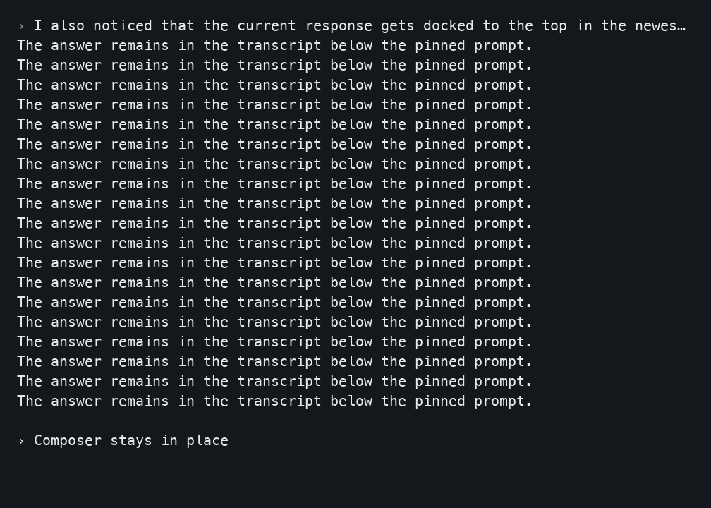
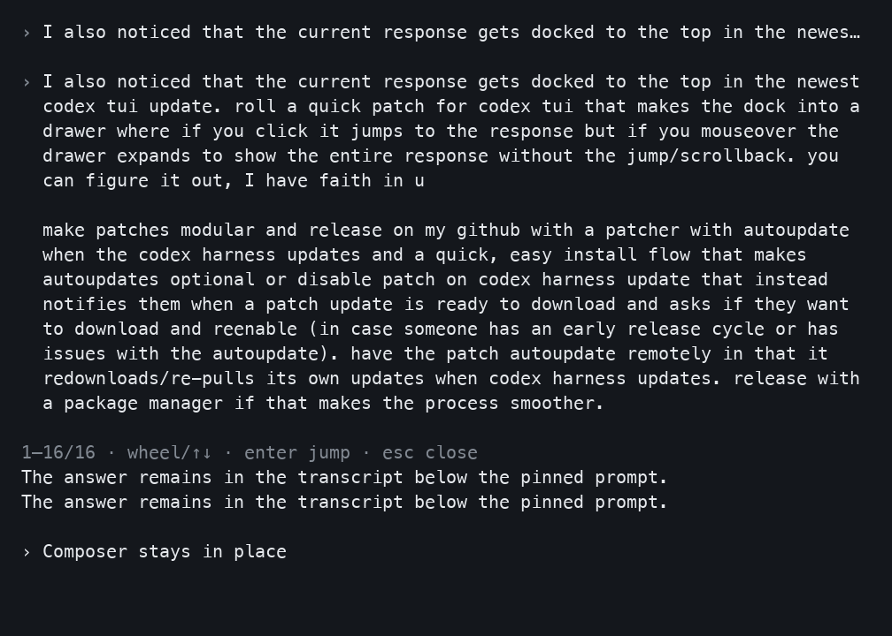

# Harness UI Session Sidebar

Unofficial community project; not affiliated with or endorsed by OpenAI or Anthropic.

A full layout for a basic setup. Extra content for a customized statusline.
For **both Codex CLI and Claude Code**, in the same download.
Full shared code is on the default branch. No feature branches or independently maintained forks.

```sh
uv tool install git+https://github.com/rachael/harness-ui-mods.git
harness-ui install --module session-sidebar
# All mods: harness-ui install --all-modules
```

The `codex-ui install` and `claude-ui install` aliases share this package and settings. `claude-ui launch` starts native Claude Code.

Start patched Codex with `harness-ui launch`; installation leaves the stock `codex` command intact.

**Choose only what you want:** `install --harness codex` · `install --harness claude` ·
`install --module info-pane` · `install --module context-drawer` · `install --module statusline` · `install --module session-sidebar`.
Component installs add to existing choices and repeated components report already included. Use `--replace-selection` to replace deliberately; unchecking an item in the installer removes it. Repeat `--module` to combine. `--all-modules` is explicit; `--dry-run` prints a plan without changes.

The optional shared session sidebar and its associated session sharing are opt-in and off by default. It shows machine-local participating session status; it does not send sessions over a network. Other selected UI features can publish their own local state independently.

Native Claude marketplace route: `claude plugin marketplace add rachael/harness-ui-mods`, then `claude plugin install info-pane@harness-ui-mods`.

[Interactive demo and individual downloads](https://rachael.github.io/harness-ui-session-sidebar/) ·
[Full source ZIP](https://github.com/rachael/harness-ui-session-sidebar/archive/refs/heads/main.zip) ·
[Detailed guide](docs/guide.md) · [Verified binary releases](https://github.com/rachael/harness-ui-mods/releases)

Defaults detect installed harnesses and ask before future updates. Reruns preserve choices,
explicit disables, custom status lines and pets. New optional features produce one dismissible
notice with remind-later/suppress controls; they are not automatically enabled.

Verified first-party compiled bundles can prepare supported subsets without Cargo.
Other patch combinations may require a 20–30 minute or longer source build.
Selection changes take effect after verification/update and a new launch.

 

Native rendered views from terminal-cell fixtures, not desktop screenshots.
The Pages interaction is separately labeled a synthetic simulation.

Authoritative implementation: [Harness UI Mods](https://github.com/rachael/harness-ui-mods).
This repository is generated by the shared exporter. `SOURCE.json` records source commit
and file hashes; submit changes to the authoritative repository and regenerate.

[Harness UI Mods](https://github.com/rachael/harness-ui-mods) · [Codex Info Pane](https://github.com/rachael/codex-info-pane) · [Claude Code Info Pane](https://github.com/rachael/claude-code-info-pane) · [Codex TUI HUD Extender Statusline](https://github.com/rachael/codex-tui-hud-extender-statusline) · [Claude Code TUI HUD Extender Statusline](https://github.com/rachael/claude-code-tui-hud-extender-statusline) · [Harness UI Context Drawer](https://github.com/rachael/harness-ui-context-drawer) · [Harness UI Session Sidebar](https://github.com/rachael/harness-ui-session-sidebar)

MIT patcher/adapter code; Apache-2.0-derived Codex changes retain upstream license/NOTICE.
See LICENSE, NOTICE and LICENSES. No personal state is included.
